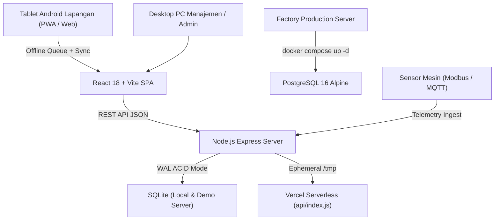

# PROJECT CONTEXT — TAIHO DIGITAL FIELD DATA COLLECTION PLATFORM

## 1. Identitas & Latar Belakang Perusahaan
- **Perusahaan**: PT Taiho Nusantara
- **Induk Perusahaan**: Taiho Kogyo Co., Ltd. (Jepang)
- **Lokasi Pabrik**: Kawasan Industri KIIC, Jl. Permata Raya Lot BB-8B, Desa Puseurjaya, Kec. Telukjambe Timur, Karawang, Jawa Barat 41361, Indonesia
- **Sektor Industri**: Manufaktur komponen otomotif presisi tinggi (engine bearings, bushings, gasket, aluminium die-casting).

---

## 2. Masalah Bisnis Inti (The Core Problem)
Dalam operasional lantai pabrik manufaktur otomotif, kendala utama bukanlah sekadar ketiadaan software, melainkan:
> **INFORMASI MEMBUTUHKAN WAKTU TERLALU LAMA UNTUK SAMPAI KE MANAJEMEN.**

### Alur Manual Konvensional (Baseline 7 Hari):
1. Teknisi/Operator mengisi lembar checklist kertas harian.
2. Kertas ditumpuk hingga akhir shift atau akhir minggu.
3. Staf administrasi melakukan pengetikan ulang (*manual re-entry*) ke spreadsheet.
4. Rekonsiliasi data dan pencocokan fisik yang memakan waktu.
5. Menunggu paraf tanda tangan bertingkat.
**Dampak:** Keterlambatan informasi hingga **7 hari (10.080 menit)**. Kerusakan mesin kecil berkembang menjadi downtime fatal, dan selisih material baru terdeteksi saat stok sudah habis.

---

## 3. Solusi & Posisi Produk
Aplikasi ini berevolusi dari *Material Loss Prevention Prototype* menjadi:
### **Digital Field Data Collection Platform**
Menerapkan filosofi: *"Capture data at the source, at the moment the work happens."*
- **Akselerasi Informasi**: Mereduksi waktu tunggu dari 7 hari menjadi **≤ 2 - 4 menit** (>99% reduksi lag data).
- **Multi-Departemen Terintegrasi**:
  1. **Pemeliharaan (Maintenance)**: Checklist mesin tablet-first, QR scan aset, pencatatan problem instan.
  2. **Material & Gudang (Loss Prevention & Ledger)**: FIFO tracking, QR scan rak, rekonsiliasi opname fisik, pelaporan scrap.
  3. **IoT Telemetry**: Abstraksi sensor getaran & temperatur mesin (Modbus, MQTT, OPC-UA).
  4. **Eksekutif & ROI**: Model simulasi finansial transparan berbasis baseline riil pabrik.

---

## 4. Arsitektur Teknologi & Database

### Komponen Teknis:
- **Frontend**: React 18, Vite, Lucide React Icons, Vanilla CSS (Industrial High-Density Dark Theme).
- **Backend**: Node.js, Express, Better-SQLite3 dengan mode Write-Ahead Logging (WAL).
- **Runtime Cloud (Vercel)**: Vercel Serverless Function (`api/index.js` mengimpor `server/index.js`). Database SQLite disalin ke `/tmp/matsys.db` (ephemeral instance storage untuk demo evaluasi langsung).
- **Blueprint Produksi Pabrik**: Konfigurasi siap pakai untuk server Linux on-premise perusahaan menggunakan Docker (`Dockerfile`, `docker-compose.yml`, dan `server/db/schema.postgres.sql`).
- **Resilience**: Offline-first via browser `localStorage` + `client_uuid` idempotency protection.

---

## 5. Matriks Peran Pengguna (Role Personas & RBAC)

| Peran | ID Teknis | Perangkat Utama | Tanggung Jawab & Hak Akses |
|---|---|---|---|
| **Operator Produksi** | `operator_produksi` | Tablet 8-11" | Checklist preventif mesin, scan QR mesin, input finding jika status FAIL/WARN. Read-only untuk audit/verifikasi. |
| **Operator Gudang** | `operator_gudang` | Handheld / Tablet | Pengeluaran material cepat ke lini, penerimaan barang vendor, stock opname fisik. Read-only untuk audit/verifikasi. |
| **Supervisor** | `supervisor` | Laptop / Tablet | Pemantauan anomali, verifikasi checklist mesin lapangan, penyelesaian resmi selisih stok (resolution). |
| **Plant Manager** | `manajemen` | Laptop / Monitor TV | Dashboard Information Lead Time, verifikasi laporan pemeliharaan, peninjauan kalkulator ROI. |
| **Administrator** | `admin` | PC Desktop | Full access: manajemen master data mesin & material, konfigurasi baseline simulasi, sistem diagnostik. |
